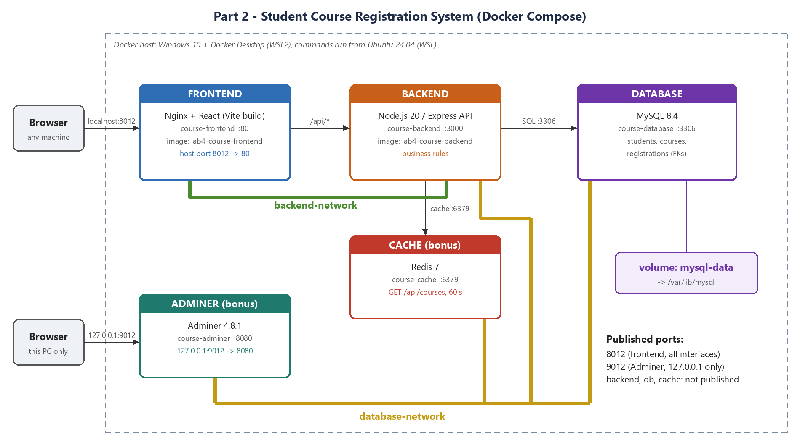

# Lab 4 - Student Course Registration System (Docker Compose)

Cloud Computing, Lab 4 - Part 2 assignment. Ahmed Salah, 202200212.

A multi-tier application deployed with one `compose.yaml`:

| Service | Image | Role | Port |
|---|---|---|---|
| frontend | `lab4-course-frontend` (built) | React app built with Vite, served by Nginx; proxies `/api/` to the backend | **8012** -> 80 |
| backend | `lab4-course-backend` (built) | Node.js 20 / Express API and business rules | 3000 (internal) |
| db | `mysql:8.4` | `students`, `courses`, `registrations` with foreign keys | 3306 (internal) |
| cache (bonus) | `redis:7-alpine` | caches `GET /api/courses` for 60 s | 6379 (internal) |
| adminer (bonus) | `adminer:4.8.1` | database admin UI, bound to 127.0.0.1 only | 127.0.0.1:9012 |

Networks: `backend-network` (frontend, backend) and `database-network` (backend, db, cache, adminer), so the
frontend cannot reach the database. MySQL data lives in the named volume `mysql-data`.



## Run

```bash
cp .env.example .env        # then set your own passwords
docker compose up -d --build
docker compose ps
```

Open http://localhost:8012 (Adminer: http://127.0.0.1:9012, server `db`).

## Business rules

- A student cannot register twice in the same course (409).
- A course cannot take more students than its seats (row lock inside a transaction, 409 "Course is full").
- Emails and course codes are unique (409); invalid input gives 400.

## Repository layout

- `compose.yaml`, `.env.example`, `backend/`, `frontend/`, `db/init.sql` - the assignment project
- `docs/` - report (PDF/Word), demo video, architecture diagrams, all screenshots
- `part1-task-manager/` - the in-class lab (Flask Task Manager) and its submission in `docs/`
